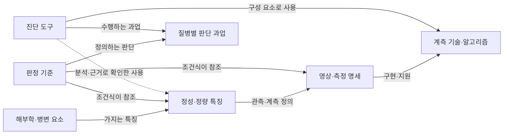

# 망막 영상 정량 지도 서비스 요구사항과 개념 설계

> 현재 우선 작업은 [조사 범위·목록 설계](40_retinal_atlas_survey_scope_v01_ko.md)의 결정이다.
> 해부 구조·병변과 특징을 먼저 정리하며 AI·알고리즘 연결은 후속으로 미룬다.
> 아래 진단 과업 중심 내용은 이전 확장 구상이며 현재 조사 범위를 확정하지 않는다.

2026-11-20 · P003 프로젝트 공통 · 검토용 초안(진단 과업 중심 개정)

이 서비스의 핵심은 **질병을 알고리즘·AI로 어떻게 판단하는지 보여주는 지식 그래프 지도**다.
해부 구조와 병변의 정성·정량 특징을 공통 사전으로 정의하고, 그 특징이 임상 판정 기준과
계측 기술, AI 진단 도구에 어떻게 쓰이는지를 근거와 함께 연결한다.

지도는 **지금 알고 있고 수집할 수 있는 범위에서 먼저 만든다.** 기존 알고리즘은 패키지로
공개해 실제로 설치·실행할 수 있게 하고, 지도의 측정 명세와 연결한다. AI 모델은 우리가 이미
사용하는 모델부터 하나씩 연결하고, 외부 최신 모델은 그 다음에 같은 기준으로 붙인다.

이 문서의 정보 구조와 추가 요구는 설계 제안이다. 현재 실행 중인 웹앱의 구현 완료 범위를
뜻하지 않으며, 이번 단계에서는 제품 코드를 변경하지 않는다.

## 1. 서비스 목적

망막 영상에서 무엇을 관찰할 수 있고, 그 요소의 어떤 특징을 기술하거나 측정할 수 있는지
설명한다. 이어서 그 특징이 질병 판단의 어떤 기준에 쓰이는지, 어떤 기술이 이를 계측하는지,
어떤 AI·알고리즘 진단 도구가 실제로 그 특징을 출력·입력·사용하는지를 근거와 함께 연결한다.

요소·특징 사전과 진단 지도는 하나의 구조다. 해부 구조와 병변의 정성·정량 특징이 모든
연결의 참조점이다. 판정 기준과 AI 사용 근거는 요소가 아니라 **특징 단위**로 연결한다.
예를 들어 DR 중증도 판정은 ‘출혈’이 아니라 ‘사분면별 출혈 개수’를 쓰고, AI 사용 근거도
‘출혈 면적·개수를 바꾸면 예측이 바뀌는가’처럼 특징 단위로만 시험할 수 있다.

초보자는 실제 영상과 쉬운 정의로 시작하고, 임상의·연구자는 측정 명세·판정 기준·알고리즘·
검증 근거·AI 사용 근거까지 따라갈 수 있어야 한다. 특정 실험이나 기존 190·178개 구현 항목
수에 서비스 범위를 종속시키지 않는다.

### 1.1 구축 단계

| 단계 | 내용 | 출발 자료 |
| --- | --- | --- |
| 1. 현재 지식으로 지도 작성 | 요소·특징 사전, 측정 명세, 판정 기준, 관계를 아는 범위에서 등록하고 나머지는 미조사로 둔다 | 일반화 분류안, 190·178 구현 등록, 공개 표준·합의 문헌, 기존 네 영상 |
| 2. 기존 알고리즘 공개 패키지 | 계측 구현을 설치·실행 가능한 공개 패키지로 정리하고 측정 명세와 연결한다(§6.1) | `ophthalmic-quantification`의 지표·주석 계약·CLI |
| 3. 우리가 쓰는 AI 모델 연결 | 모델 카드와 사용 특징 프로파일을 하나씩 등록한다(§8) | RETFound(안저·OCT), VisionFM, EfficientNetV2-S DR 모델 등과 기존 DR·flip study 결과 |
| 4. 외부 최신 AI 확장 | 감시·선정 기준에 따라 외부 모델을 같은 분석 묶음으로 추가한다 | 공개 기반 모델, VLM, 과업 특화 모델 |

각 단계는 앞 단계가 완벽히 채워지기를 기다리지 않는다. 빈 칸은 상태값(§9)으로 드러내고,
지도·패키지·모델 연결을 작은 단위로 함께 늘려 간다.

## 2. 서비스 요구

| 요구 | 답해야 하는 질문 | 제공할 내용 |
| --- | --- | --- |
| 1. 해부학적 요소와 특징 | 무엇이 있으며 어떤 크기·모양·배열·신호 특성을 가지는가? | 위치·역할·실제 영상, 정성적 특징, 정량적 측정 개념 |
| 2. 병변 요소와 특징 | 어떤 비정상 소견을 관찰하고 무엇을 기술·측정할 수 있는가? | 병변 정의·발생 위치·영상별 외관, 존재·종류·위치·형태·신호·분포·양·시간 변화 |
| 3. 질병별 판정 | 해당 질병을 판단할 때 어떤 특징을 어떤 기준으로 조합하는가? | 진단·감별·중증도·활동성·예후·경과 관찰별 판정 기준과 근거 |
| 4. 기술의 계측 능력 | AI 또는 알고리즘이 어떤 특징을 찾아 어떤 결과를 낼 수 있는가? | 검출·분할·정성 기술·정량 계측별 지원 범위, 입력 조건·출력·검증 |
| 5. 진단 도구의 실제 사용 | 특정 도구가 어떤 특징을 출력·입력하거나 판단에 사용하는가? | 도구·버전·과업별 입출력, 사용 관계의 근거와 미확인 부분 |
| 6. 관계 지도 | 위 내용을 연결해 탐색할 수 있는가? | 요소–특징–측정–판정 기준–기술–진단 도구의 관계와 출처 |
| 7. 최신 AI의 지속 분석 | 새 AI 기술은 어디를 보고 무엇을 사용하는가? | 표준 분석 묶음의 결과, 모델별 사용 특징 프로파일, 버전별 이력 |

1·2가 공통 사전을 소유하고, 3·4·5는 그 사전의 특징을 참조한다. 6은 같은 정보를
관계로 탐색하는 화면이다. 7은 5의 근거를 계속 생산하는 분석 체계다(§8).
요구의 개수가 곧 최상위 메뉴의 개수가 될 필요는 없다.

## 3. ‘표준’의 의미와 등록 단위

공통 사전은 표준 용어·합의 정의·명시된 측정 방법을 우선한다. 그러나 서비스가 등록한
모든 개념을 국제 표준이나 확정된 임상 지표로 표시해서는 안 된다.

| 정의의 상태 | 표시할 정보 |
| --- | --- |
| 표준·전문가 합의에 근거 | 발행 기관·문헌·판본·해당 정의의 범위 |
| 연구에서 사용하는 정의 | 원 연구와 적용한 영상·대상·방법 |
| 여러 정의가 병존 | 정의별 차이, 비교·변환 가능 여부 |
| 서비스의 정리안 | 제안임을 표시하고 근거·검토 상태 연결 |

정상 참고범위, 진단 기준값, 연구 집단의 평균은 별도로 취급한다. 정상 참고범위에는
연령·축장·장비·측정 구역 등 적용 집단과 조건을 붙인다. 공통 용어가 있다는 사실만으로
보편적인 정상 수치나 질병 판정 임계값이 있다고 표시하지 않는다.

OCT 층·band 명칭은 [IN•OCT 용어 합의](https://pubmed.ncbi.nlm.nih.gov/24755005/) 등
원 정의를 연결한다. 측정 구역·장비·분할 방법의 명시는
[APOSTEL 2.0](https://pubmed.ncbi.nlm.nih.gov/33910937/)의 정량 OCT 보고 원칙을 참조한다.

요소와 질병에는 외부 용어 코드 필드를 둔다. 해부 구조는 UBERON, 안과 표현형은
[HPO의 안과 표현형 합의](https://pubmed.ncbi.nlm.nih.gov/30626441/), 임상 용어는
SNOMED CT·ICD-11에 대응을 시도한다. 대응이 없으면 비워 두고 ‘외부 코드 미대응’으로
표시한다. 외부 코드는 한영 동의어 검색의 기반으로도 쓴다.

## 4. 공통 사전의 내용

### 4.1 요소와 특징을 나눈다

‘혈관’은 요소이고, ‘폭·구불거림·분지 형태’는 그 특징이다. ‘망막층’은 요소이고
‘두께·연속성·층 배열’은 특징이다. ‘출혈’은 병변 요소이고 ‘존재·종류·사분면별 개수·
투영 면적·분포’는 그 특징이다. 하나의 요소가 정성적 특징과 정량적 특징을 모두 가진다.

| 요소의 예 | 정성적 기술의 예 | 정량적 측정의 예 | 구별할 조건 |
| --- | --- | --- | --- |
| 망막 혈관 | 동맥/정맥, 분지 양상, 굴곡·구경 변화 | 국소 폭, 길이, 분지각, 구불거림, 정의된 밀도 | 가시 혈관/flow 신호, ROI, 배율, 경로·산식 |
| 망막층·외망막 | 층 배열, band 보존·단절 | 층 두께, 부피, 단절 범위 | 경계·층 정의, 스캔 위치, 2D/3D, 간격 |
| 맥락막 | 경계·혈관층의 외관 | 두께, 정의된 혈관성 영역 비율 | 구조 OCT와 OCTA 관측량의 차이 |
| 출혈·삼출물·드루젠 | 존재, 종류, 위치·분포 양상 | 개수, 면적, 높이·부피 등 가능한 계측 | 병변별 정의, 영상별 가시성, 2D/3D |
| 망막내액 공간 | 존재, 위치, 낭성 양상 | 단면 면적, 3D 부피 | compartment 정의, 분할, voxel 간격 |
| 외망막·RPE 변화 | 저투과 띠, RPE 소실, 광수용체 변화 | 정의된 범위·면적·확장률 | 개별 신호·층 변화의 계측 |

cRORA처럼 여러 신호·층 변화를 합의 규칙으로 조합한 소견은 단일 요소로 등록하지 않는다.
구성 특징은 사전에 두고, 조합 규칙은 판정 기준(§5.1)으로 등록한다.

해부 구조와 병변을 화면에서는 구분하지만, 서로 단절된 중복 사전으로 만들지 않는다.
예를 들어 혈관 이상 소견은 정상 혈관 구조와 관계를 맺고, 외망막 변화는 영향을 받는
층·RPE와 연결한다. 단일 공통 ID와 구조–소견 관계를 사용한다.

### 4.2 병변 특징의 축

병변 요소마다 아래 축의 정성·정량 특징을 등록한다. 해당하지 않는 축은 ‘해당 없음’으로,
아직 정의하지 않은 축은 ‘미정의’로 표시한다.

| 축 | 정성적 특징 | 정량적 특징 | 예: 출혈 | 예: 망막내액 |
| --- | --- | --- | --- | --- |
| 존재·종류 | 있음/없음/평가 불가, 하위 유형 | — | 점·얼룩·화염상 | 낭성·미만성 |
| 위치 | 층, 구역(ETDRS·사분면), 중심와와의 관계 | 중심와까지의 거리 | 사분면 | 내핵층·외망상층, 중심 침범 |
| 양 | — | 개수, 면적, 부피 | 사분면별 개수, 투영 면적 | B-scan 단면 면적, 3D 부피 |
| 크기·형태 | 경계, 모양 | 최대 직경, 높이 | 크기 범주 | 최대 높이 |
| 신호 | 반사도·색조 | 강도 통계 | 색조 | 내부 저반사 |
| 분포 | 산재·군집·환상 | 침범 범위, 구역 수 | 침범 사분면 수 | 침범 ETDRS 구역 수 |
| 시간 | 새로 생김·소실·악화 | 변화량, 변화율 | 증감 | 치료 후 부피 변화 |

해부 구조도 같은 방식으로 형태·크기·배열·신호·연속성·시간 축의 특징을 등록한다.
모든 특징에는 영상별 관측 가능성(§4.4)과 정의의 상태(§3)를 붙인다.

### 4.3 정성·정량의 출력 형식

존재/부재, 명목 범주, 순서 등급, 연속 수치, 위치·분포 기술을 구분한다. ‘정성적’이라는
이유로 정의 없는 자유 서술만 저장하지 않는다. 판단 기준과 예시를 함께 둔다.
알고리즘이 쓴 자연어 설명은 검토된 표준 소견과 구분한다.

‘관찰되지 않음’, ‘촬영 범위 밖’, ‘품질 때문에 평가 불가’, ‘아직 조사하지 않음’을
구분한다. 이를 병변 없음이나 수치 0으로 대체하지 않는다. 이 관측 상태는 서비스의
예시 영상 표식과 도구 출력 명세에 적용한다. 서비스는 환자 영상을 받아 판정하지 않는다.

### 4.4 영상별 관측 가능성

공통 요소를 안저·OCT·OCTA에서 각각 어떻게 관측하는지 연결한다. 영상 종류가 다르다는
이유로 개념을 무조건 복제하지 않고, 같은 명칭이라는 이유로 다른 관측량을 합치지도 않는다.

- 단일 2D 안저 사진의 혈관 폭·투영 면적에서 해부학적 혈관 부피를 직접 얻었다고 하지 않는다.
- 혈관 부피에는 무엇의 부피인지, 3D 입력·분할·공간 보정과 산출 근거를 명시한다.
  모델로 추정했다면 추정 결과로 표시한다.
- OCTA에서 검출한 flow-signal 영역·부피는 그 정의를 유지한다. 검증 없이 해부학적
  혈관 내강 부피나 혈류량으로 이름을 바꾸지 않는다.
- OCT 단면의 액체 공간 면적과 3D scan의 액체 부피를 다른 측정 명세로 둔다.
- 일반 영상 강도·질감과 해부학적 조직의 직접 계측을 구분한다.

상세 모달리티 분류는 [일반화 분류안](10_retinal_image_measurement_concept_taxonomy_v01_ko.md)을
기반으로 재사용한다.

## 5. 질병별 판정

질병 페이지는 질병명 아래에 지표를 나열하는 데 그치지 않고 **어떤 판단에 어떤 특징을
어떤 기준으로 쓰는지**를 설명한다. 진단, 감별, 중증도 분류, 활동성 평가, 예후 예측,
경과·치료 반응 관찰을 구분해 같은 특징이 여러 역할로 연결될 수 있게 한다.

관계마다 질병·판단 과업, 사용하는 특징·측정 명세, 적용 영상, 조합 조건, 근거 문헌·판본,
권고/합의/관찰연구 등의 근거 종류를 기록한다. 임상에서 사용하는 기준과 연구 연관성을
같은 ‘진단에 사용’으로 표시하지 않는다.

### 5.1 판정 기준 단위

판정 기준은 특징·측정 명세를 참조하는 독립 정보 단위다. 단일 측정 하나와 질병을 선으로
연결한 그림만으로 기준의 논리를 대신하지 않는다.

| 항목 | 내용 |
| --- | --- |
| 대상 | 질병 × 판단 과업(예: DR 중증도, nAMD 활동성) |
| 조건식 | 참조하는 특징과 논리 조합(그리고/또는/몇 개 이상), 임계값·단위 |
| 위치·범위 조건 | 사분면·ETDRS 구역·중심 침범 등 |
| 제외 조건 | 다른 원인 배제, 영상 품질 조건 |
| 출력 | 판정 범주·등급과 그 순서 |
| 출처 | 분류 체계·판본·적용 범위, 근거 종류 |

예를 들어 DR 중증도는 [국제 임상 분류 합의](https://pubmed.ncbi.nlm.nih.gov/13129861/)와
ETDRS 4-2-1 규칙처럼 사분면별 출혈 개수, 정맥 염주양의 사분면 수, IRMA 존재를 조합한다.
AMD 관련 OCT 위축은 개별 신호·층 변화의 측정과 cRORA 등 합의 판정의 조합을 나누어
[CAM Report 3](https://pubmed.ncbi.nlm.nih.gov/29103793/)에 연결한다. 이 예시들은
각 정의의 적용 범위를 보여주며 모든 질병의 최신 기준을 수록했다는 뜻은 아니다.

공통 소견이 여러 질병에서 보일 수 있다는 관계도 보존한다. 지도의 핵심 비교 화면은
‘임상 판정 기준이 쓰는 특징’과 ‘AI 진단 도구가 실제로 쓴다는 근거가 있는 특징’의 대비다.

## 6. AI·알고리즘의 계측 능력

기술 이름보다 **구체적인 과업과 출력**을 등록 단위로 삼는다. 하나의 소프트웨어가 여러
과업을 지원할 수 있지만 각 과업의 입력·검증 범위는 따로 기록한다.

| 과업 | 결과 | 계측 능력을 표시하는 조건 |
| --- | --- | --- |
| 검출 | 존재 여부·위치·box | 검출 대상과 평가 단위를 명시 |
| 분할 | 구조·병변의 mask/경계 | label 정의와 분할 검증 연결 |
| 정성 기술 | 소견 범주·등급·설명 | 표준 용어 대응과 일치도·검토 상태 연결 |
| 정량 계측 | 폭·두께·면적·부피·형태 수치 | 측정 명세·단위·보정·오차 연결 |
| 질병 판단 | 질병/중증도/의뢰 등의 출력 | 해당 진단 과업의 검증을 별도로 연결 |

분할 mask를 낼 수 있다는 사실만으로 물리 단위 부피 계측의 정확도가 검증됐다고
표시하지 않는다. 계측 단계가 별도 알고리즘이면 `분할 → 측정 연산 → 결과`를 드러낸다.
전통 영상처리·반자동·수동 기준 측정도 같은 개념에 연결한다.

기술별 필수 정보는 입력 영상·장비/촬영 조건, 요소·특징·출력 형식, 방법·버전,
평가 자료·집단, 기준 정답·평가 단위, 오차·반복성·외부 검증, 코드·모델·라이선스다.
분할 Dice와 계측 오차, 진단 민감도 등을 같은 성능 숫자로 비교하지 않는다.

대표 사례로 [AutoMorph](https://pubmed.ncbi.nlm.nih.gov/35833885/)는 안저 영상의
구조 분할과 혈관 형태 계측을 연결한다. [MIRAGE, 2025](https://pubmed.ncbi.nlm.nih.gov/40999048/)는
OCT/SLO의 분류·분할 과업을 평가한다. 이 사례들로 계측과 분류의 등록 방식 차이를
설명할 수 있다. 기반 모델의 명칭만으로 모든 망막 요소의 계측을 지원한다고 등록하지 않는다.

‘최근’ 기술은 발표 연도·검토일·모델/코드 버전으로 관리한다. 연구 결과, 공개 실행 가능,
외부 검증, 임상 사용 및 규제 허가 여부는 서로 별도 속성이다.

### 6.1 공개 패키지와 지도의 연결

우리가 가진 계측 알고리즘은 지도에 설명만 두지 않고, 공개 패키지로 실제 사용할 수 있게 한다.
지도의 측정 명세 상세에는 이를 구현한 패키지 함수·지표 ID·버전과 실행 예시가 연결된다.

| 항목 | 요구 |
| --- | --- |
| 지표 연결 | 패키지의 지표 ID를 측정 명세에 `implements`로 연결한다. 이름이 같다는 이유로 연결하지 않는다 |
| 입력 조건 | 필요한 영상·mask·landmark와 upstream 모델 출력을 명시한다. 모델 의존 값은 원영상에서 꾸며내지 않는다 |
| 출력 | 단위, 결측 사유(평가 불가·미관측 등)를 보존한다. 결측을 0으로 바꾸지 않는다 |
| 검증 | 단위 테스트, 합성 예제, 기존 실험의 계산 일치 검증을 근거로 연결한다 |
| 사용성 | 설치 방법, 공개 API·CLI 문서, 비식별 합성 예제로 외부 사용자가 바로 실행할 수 있게 한다 |
| 공개 범위 | 환자 원자료·제한 자료·식별자는 포함하지 않는다 |
| 라이선스 | 우리 코드의 공개 라이선스를 정한다. 외부 코드·모델 가중치·학습 자료에서 유래한 checkpoint는 재배포 조건을 확인한 뒤 포함 여부를 정한다 |

웹 지도는 읽기·탐색형으로 유지하고, 실제 계산은 사용자가 공개 패키지를 자기 환경에서 실행한다.

## 7. 진단 도구가 실제 사용하는 특징

다음 세 질문은 각각 답이 필요하다.

1. 그 도구가 특징을 검출하거나 측정해서 **출력하는가**?
2. 그 특징이 진단 단계의 **입력 또는 중간 표현인가**?
3. 그 특징이 특정 판단에 **영향을 주는 근거가 있는가**?

독립 계측 도구가 혈관 폭을 계산한다는 사실만으로 다른 진단 모델이 혈관 폭을 사용한다고
추론하지 않는다. 같은 다중 과업 모델이 병변과 질병을 함께 출력해도 둘 사이의 정보 경로를
확인해야 한다. 학습 때 사용한 label·보조 과업·전문가 지식 텍스트와 추론 때 사용하는
입력도 구분한다. 지식을 학습에 주입했다는 사실은 추론 때 그 특징을 쓴다는 근거가 아니다.

| 사용 관계의 근거 | 화면에서 가능한 표현 |
| --- | --- |
| 논문·개발자 설명 | ‘사용한다고 보고됨’과 해당 자료 |
| 코드·구조에서 입력/중간 표현 확인 | ‘진단 단계에 입력됨’과 버전·정보 경로 |
| 소견·측정과 출력의 관련성 분석 | ‘출력과 연관됨’과 자료·조건 |
| 제거·교란·통제 실험 | ‘해당 조건에서 예측 영향 관찰/미지지’와 실험 한계 |
| 독립 재현 | 무엇을 어느 자료에서 재현했는지 연결 |
| 미확인 | ‘실제 사용 특징 미확인’ |

이들은 단일한 점수나 엄격한 일렬 등급이 아니다. 같은 관계에 여러 근거가 함께 존재할 수
있고 결과가 충돌할 수도 있다. 관련성이 인과를 확정하지 않으며, 교란 실험에도 영상의
현실성·동반 변화·분포 이동 같은 해석 조건이 붙는다. 미확인은 미사용을 뜻하지 않는다.

attention·saliency 그림만으로 임상 개념의 실제 사용을 확정하지 않는다.
[Saliency 원 연구의 검증 문제](https://proceedings.neurips.cc/paper/2018/hash/294a8ed24b1ad22ec2e7efea049b8737-Abstract.html)를
근거로, 본 서비스는 위치 설명(어디를 보는가)과 사용 관계의 검증(무엇을 쓰는가)을
별개로 기록한다.

질병 예측만 제공하는 영상 모델은 해당 예측 과업을 등록할 수 있다. 요소별 사용 근거를
찾지 못한 경우 연결을 채워 넣지 않고 미확인으로 남긴다. 규제 승인 기기 다수는 학습 자료와
성능 근거의 공개도 제한적이다([안과 AIaMD 범위 검토, npj Digit Med 2025](https://doi.org/10.1038/s41746-025-01726-8)).
이런 기기의 특징 사용 관계가 미확인으로 남는 것 자체를 근거 공백으로 보여준다.

## 8. 최신 AI 기술의 지속 분석

지도는 한 번 작성하고 끝나는 자료가 아니다. 새 AI 기술이 나오면 같은 특징 사전·평가 자료·
검사 순서로 분석해 §7의 근거를 추가한다. 모델 간 비교는 이 세 가지를 고정할 때만 가능하다.

이 분석은 독립 study [retinal_ai_feature_use](../../studies/retinal_ai_feature_use/README.md)가
소유한다. 연구 질문·claim gate·실행 순서는 그 study를 따르고, 이 절은 서비스가 받아들이는
근거의 형식을 정의한다.

적용 순서는 우리가 이미 사용하는 모델이 먼저다. 각 모델은 모델 카드(입력·과업·버전·출처·
라이선스)를 먼저 등록하고, 기존 study 결과로 채울 수 있는 칸을 근거와 함께 채운다. 나머지 칸은
미확인으로 두고 분석 묶음으로 하나씩 채운다. 외부 최신 모델은 그 다음 단계다.

### 8.1 표준 분석 묶음

| 질문 | 방법 | 얻는 근거 | 해석 한계 |
| --- | --- | --- | --- |
| 어디를 보는가 | attribution·attention·occlusion과 병변·구조 mask의 비교 | 주목 영역과 특징 위치의 일치 | 위치 일치는 사용이 아니다 |
| 표현에 들어 있는가 | 내부 표현으로 특징값을 예측하는 probe | 특징 정보의 존재 | 존재해도 판단에 쓰지 않을 수 있다 |
| 예측과 연관되는가 | 특징값과 예측의 관련성 분석 | 연관 | 교란 요인 |
| 바꾸면 예측이 바뀌는가 | 특징 단위 개입: 병변 제거·추가·크기 변경, 특징을 가린 통제 비교 | 해당 조건의 예측 영향 | 영상 현실성·동반 변화·분포 이동 |
| 설명과 실제가 일치하는가(VLM) | 모델이 말한 근거 특징에 대한 개입 | 설명의 충실도 | 자연어 설명은 메커니즘이 아니다 |

각 단계의 통과 기준과 평가 자료(병변 mask가 있는 DR 자료, OCT 액체 분할 자료 등)는
분석 전에 고정한다. 결과가 단계마다 엇갈리면 그대로 함께 기록한다.

### 8.2 사용 특징 프로파일

모델마다 특징 단위로 ‘어디를 보는가 / 표현에 존재 / 예측과 연관 / 개입 시 영향 / 설명 충실도’를
한 표로 정리한다. 프로파일에는 모델·버전, 입력 영상, 판단 과업, 평가 자료, 분석일,
GPU 장치를 포함한 실행 조건을 붙인다. 프로파일의 각 칸은 지도의 근거 연결로 등록된다.

### 8.3 추적 대상과 주기

| 대상 | 예 | 분석 방식 |
| --- | --- | --- |
| 우리가 사용하는 모델(1차) | RETFound 안저·OCT, VisionFM, EfficientNetV2-S DR 모델 | 기존 결과를 먼저 등록하고 빈 칸을 표준 분석 묶음으로 채움 |
| 공개 기반 모델 | RETFound, FLAIR, KeepFIT 계열 등 | 가중치를 받아 표준 분석 묶음을 직접 실행 |
| 망막 VLM·범용 멀티모달 모델 | 망막 특화 VLM, 범용 대형 모델 | 직접 실행, 설명 충실도 검사 포함 |
| 과업 특화 모델 | DR 분류·병변 분할 모델 | 코드·가중치가 공개된 것만 직접 실행 |
| 상용·규제 승인 기기 | DR 자동 선별 기기 등 | 문헌·공개 자료만 등록, 나머지는 미확인 |

- 외부 모델 감시는 1차 모델의 연결 양식이 정해진 뒤 시작한다.
- 문헌·모델 감시는 정해진 주기(월 또는 분기)로 수행하고, 검색 조건과 선정 결과를 기록한다.
- 선정 기준은 가중치 공개 여부, 우선 질병과의 관련성, 인용·임상 영향력이다.
- 모델 버전이 바뀌면 같은 분석 묶음을 다시 실행하고 이전 결과를 이력으로 보존한다.
- 직접 분석은 GPU에서 실행하고 사용한 장치를 결과물에 기록한다.

### 8.4 가까운 기존 연구와의 관계

해부·표현형 온톨로지(UBERON, HPO 안과 표현형, [OcIMIDo](https://bioportal.bioontology.org/ontologies/OCIMIDO)),
바이오마커 해설, 개별 계측 도구, 모델 내부에 지식 그래프를 쓰는 진단 모델,
[망막 영상 개념 기반 XAI 리뷰](https://link.springer.com/article/10.1007/s10278-026-02391-3)는
각각 지도의 한 층을 다룬다. 이 서비스는 그 층들을 특징 단위로 잇고, 여러 모델의
특징 사용 근거를 같은 기준으로 비교·갱신한다는 점에서 구별된다.

## 9. 핵심 정보와 관계

| 정보 단위 | 소유하는 내용 |
| --- | --- |
| 요소 | 해부학 구조 또는 병변·소견의 정의, 구조·위치 관계, 외부 용어 코드 |
| 특징 | 해당 요소의 정성/정량 속성과 의미, 특징 축 |
| 관측·측정 명세 | 모달리티·구역·경계·산식·단위·획득 조건 |
| 판정 기준 | 질병 × 판단 과업 × 특징 조건식 × 위치·제외 조건 × 출력 |
| 기술 과업 | 구현·버전 × 입력 × 계측/기술 출력 × 검증 |
| 진단 시스템 | 모델·버전·과업·입력/중간 표현·사용 구성 요소·판단 출력 |
| 분석 결과 | 표준 분석 묶음의 단계별 결과, 사용 특징 프로파일 |
| 근거 | 정의·관계·검증을 지지하는 문헌/코드/실험과 해당 위치 |
| 실제 영상 예시 | 원본·모달리티·표시 위치·추가 표식·라이선스 |

관계의 기본 골격은 다음과 같다.

이 그림의 화살표 방향은 탐색 관계이며 인과 방향이 아니다. 진단 도구가 실제로 읽는
입력은 원영상·mask·수치·임상 기록 등으로 따로 명시한다.

관계는 시작·도착 단위가 정해진 닫힌 목록으로 관리하고, 새 관계 종류는 검토 후 추가한다.

| 관계 묶음 | 관계 | 시작 → 도착 |
| --- | --- | --- |
| 구조 | `is_a`, `part_of`, `located_in`, `affects` | 요소 → 요소 |
| 특징·측정 | `has_feature`, `observed_by`, `measured_by`, `derived_from`, `proxy_of` | 요소 → 특징, 특징 → 측정 명세, 측정 명세 → 측정 명세 |
| 판정 | `criterion_uses`, `defines_task` | 판정 기준 → 특징·측정 명세, 판정 기준 → 판단 과업 |
| 기술·도구 | `implements`, `performs_task`, `uses_component` | 기술 과업 → 측정 명세, 진단 시스템 → 판단 과업·기술 과업 |
| 사용 근거 | `outputs_feature`, `consumes_feature`, `prediction_influence_tested` | 진단 시스템 → 특징 |

`proxy_of`에는 산식 차이·관측량 차이·상관 관계 중 무엇인지를 함께 적는다.
근거·적용 조건·상태·버전·검토일은 관계 종류가 아니라 각 관계에 붙는 속성으로 둔다.
질병 맥락을 공유한다는 사실로 산식 동등성·기술 지원·모델 사용 관계를 자동 생성하지 않는다.

상태값은 적용 대상에 따라 세 체계로 나눈다.

| 체계 | 상태값 | 적용 대상 |
| --- | --- | --- |
| 관측 상태 | 관찰됨 / 관찰되지 않음 / 촬영 범위 밖 / 평가 불가 / 미조사 | 예시 영상 표식, 도구 출력 명세 |
| 관계 근거 상태 | 지지 / 반박 / 근거 충돌 / 미확인 | 모든 관계 |
| 기술 능력 상태 | 지원·검증됨 / 지원·검증 부족 / 미지원 / 미조사 | 기술 과업의 계측 능력 |

## 10. 관계 지도

### 10.1 기존 지도에서 유지할 부분

사용자가 지정한 기존 관계 지도의 원본은 E017 reports의
[`ophthalmic_full_metric_relationship_map_v01_ko.html`](../../experiments/E017_ophthalmic_quantification_engine/artifacts/reports/ophthalmic_full_metric_relationship_map_v01_ko.html)이다.
파일 내부 데이터는 190개 구현 항목, 8개 질병, family 간 11개 명시적 파생 관계와
별도의 질병 맥락 연결을 가진다. T1–T4·Analysis/QC 배치, 선택 노드 강조와 선 종류
필터를 사용한다. 질병 맥락 점선은 인과·파생·진단 성능을 뜻하지 않는다고 명시돼 있다.

선의 의미를 구분하고 선택 노드 주변을 강조하는 방식은 유지할 수 있다. 기존 Tier와
190개 항목은 일반 해부학·병변 분류의 기본 골격으로 쓰지 않고 구현 출처로 연결한다.

### 10.2 새 지도에서 필요한 탐색

| 시작점 | 확인할 연결 |
| --- | --- |
| 요소·특징 | 가능한 측정 → 이를 쓰는 판정 기준 → 계측 도구 → 이를 쓴다는 근거가 있는 진단 도구 |
| 질병·판단 과업 | 판정 기준 → 참조 특징·측정 → 각 특징의 AI 사용 근거 대비 |
| 계측 도구 | 지원 특징 → 출력 → 검증·한계 |
| 진단 도구 | 원영상/명시적 특징 입력 → 사용 특징 프로파일 → 미확인 부분 |
| 기존 구현 항목 | 공통 개념 → 같은/다른 측정 명세 → proxy·파생 관계 |

기본은 한 시작점의 인접 관계만 보여주고 필요할 때 한 단계씩 펼친다. 전체 보기는
대상군 단위로 묶는다. 영상·관계 종류·근거 상태로 필터하고, 선을 선택하면 근거를 연다.
그래프와 같은 내용을 읽을 수 있는 표 목록을 함께 제공한다.

그래프 자체는 구현 가능하다. 실제 연결의 충실도는 관계별 근거를 얼마나 수록하느냐에
달려 있다. 근거가 없는 모델 사용 관계를 그림을 완성하기 위해 추정해서 채우지 않는다.

## 11. 단순한 페이지 구성 제안

지식은 여러 관계를 가지더라도 처음 보이는 메뉴와 한 화면의 과업은 단순하게 유지한다.

| 주 메뉴 | 목록에서 하는 일 | 상세에서 하는 일 |
| --- | --- | --- |
| 요소·특징 사전 | 해부학/병변, 이름·동의어, 영상 종류로 찾기 | 무엇인가 → 실제 영상 → 정성·정량 특징 → 어떻게 측정하는가 |
| 질병별 판정 | 질병과 판단 목적 선택 | 판정 기준·참조 특징·근거, 임상 기준과 AI 사용 근거의 대비 |
| 기술·도구 | ‘계측 기술’ 또는 ‘진단 도구’ 선택 | 계측 지원·검증, 또는 사용 특징 프로파일·근거 |
| 관계 지도 | 요소·질병·도구 중 시작점 선택 | 연결을 펼치고 관계별 근거 확인 |

‘기술·도구’ 메뉴는 하나로 두더라도 상세 화면에서 계측 기술과 진단 도구를 분리한다.
계측 도구가 어떤 특징을 잰다는 사실이 진단 도구의 사용 근거로 읽히지 않게 한다.

홈은 짧은 소개·검색·네 진입점으로 구성한다. 문서의 전체 설계 설명과 구현 상태를
홈의 주 콘텐츠로 늘어놓지 않는다. 각 영역과 상세 항목은 별도 URL을 가지며,
페이지 간 연결은 해당 개념의 상세로 이동한다. 메뉴마다 공통 설명을 복사하지 않는다.

요소 상세의 기본 읽기 순서는 쉬운 정의, 가장 큰 해부 구조의 위치, 실제 영상과
표식, 정성/정량 특징이다. 측정식·장비 조건·검증은 다음 깊이에 둔다. 해부학 색상과
병변 강조는 구별하고, 원본과 추가 표식을 나누며, 층 위치 안내와 실제 분할을 구분한다.
‘측정 가능’과 ‘이 예시 이미지에서 실제 측정 완료’도 다르게 표시한다.

현재 샘플 앱의 `/anatomy/`·`/lesions/`는 요소·특징 사전으로, `/blueprint/`는 사전의
분류 설명으로, `/sources/`는 근거·출처 화면으로 옮기는 것을 기본안으로 둔다.
청사진과 출처·라이선스는 필요할 때 열 수 있게 두되 상시 주 메뉴를 늘리는 근거로
삼지 않는다. 최종 화면 배치는 본 요구사항 검토 후 별도로 작성한다.

## 12. 추가할 요구와 우선순위

| 추가 요구 | 필요한 이유 | 범위 제안 |
| --- | --- | --- |
| 관측 가능성과 측정 조건 | 같은 말로 다른 물리량을 설명하는 오류 방지 | 첫 설계부터 필수 |
| 병변 특징 축 | 판정 기준과 AI 근거를 특징 단위로 연결 | 첫 설계부터 필수 |
| 판정 기준 단위 | 조합·임계값·제외 조건을 선 하나로 대체하지 않음 | 첫 설계부터 필수 |
| 정의·임상·기술·모델 사용 근거 | 표준·연구·지원 능력·실제 사용을 구별 | 첫 설계부터 필수 |
| 기존 알고리즘 공개 패키지 | 지도의 측정을 실제로 계산할 수 있게 함 | 2단계부터 필수(§6.1) |
| 모델 카드 | 연결한 AI 모델의 입력·과업·버전·출처·라이선스 | 3단계의 첫 모델부터 필수 |
| 표준 분석 묶음과 사용 특징 프로파일 | AI 모델을 같은 기준으로 비교·갱신 | 우리가 쓰는 모델부터 적용 |
| 측정 품질·실패·불확실성 | 0·부재와 평가 불가를 구별하고 수치를 해석 | 첫 설계부터 필수 |
| 정상 변이·참고범위 | 크기·두께가 무엇과 비교되는지 설명 | 구조와 적용 조건을 먼저 마련 |
| 공통·감별 소견 | 한 소견을 한 질병과 자동 동일시하지 않도록 함 | 판정 기준 설계에 포함 |
| 시간 변화·치료 반응 | 단일 시점의 양과 진행·반응의 차이 | 변화량·정합·시간 간격을 지원하는 구조 |
| 측정 간 비교 가능성 | 장비·ROI·slab·정의가 다른 수치의 무조건 합산 방지 | 측정 명세의 필수 항목 |
| 근거 공백 탐색 | 임상적으로 필요하지만 계측/사용 근거가 부족한 부분 찾기 | 관계 근거 상태와 미조사 상태를 활용 |
| 검색·동의어·한영 용어·외부 코드 | 초보자 표현과 전문 용어를 같은 개념으로 연결 | 목록의 기본 기능 |
| 출처·버전·이미지 권리 | 변경된 정의·모델을 추적하고 영상을 재사용 | 모든 자료의 공통 속성 |
| 콘텐츠 작성·검토 절차 | 근거 작성자·검토자·충돌 정리·재검토 주기 | 첫 시범 사례에서 양식 확정 |
| 데이터 내려받기 | 표·관계를 연구·검토에 재사용 | 후속 기능 |
| 웹 영상 업로드·실시간 추론 | 지식 안내에서 실행형 서비스로 범위가 확대됨 | 웹에서는 후속 검토. 로컬 실행은 공개 패키지로 제공 |

AI의 ‘미지원’, ‘검증 부족’, ‘아직 조사 안 됨’은 다른 상태다(§9 상태값). 공백 지도에서도
이를 분리해야 한다. 영상 자료가 아직 없는 개념과, 해당 영상에서 관측할 수 없는 개념도 구분한다.

## 13. 기존 190·178 자료의 위치

기존 항목은 원 ID·출처를 보존한 구현 등록으로 연결한다. 공통 개념의 개수와 동일시하지
않는다. 같은 대상·특징이라도 측정 구역·산식·영상·단위가 다르면 다른 명세로 연결한다.
정확한 대응을 확인하기 전에는 후보 관계 또는 proxy로 둔다.

QC·분할 평가·임상 기록·모델 출력·일반 질감/신호 측정은 그 역할에 맞게 연결한다.
해부학·병변의 직접 계측으로 일괄 편입하지 않는다. 구현이 있다는 사실은 임상 진단에
채택됐다는 근거가 아니며, 특정 진단 모델의 사용 근거도 아니다.

1단계 지도의 구현 등록은 이 자료와 `ophthalmic-quantification`의 공개 API에서 시작한다.

## 14. 설계 평가 기준

1. 사용자가 요소의 정의·실제 영상·정성적 특징·정량 측정 가능 범위를 찾을 수 있다.
2. 병변 요소마다 §4.2의 특징 축이 등록되거나 ‘해당 없음/미정의’로 표시된다.
3. 같은 요소·특징을 질병·기술·지도에서 열면 동일한 공통 정의를 참조한다.
4. 2D 폭·면적과 3D 부피, 구조와 flow 신호, 직접 계측과 추정을 구별한다.
5. 측정에는 대상·영상·구역·방법·단위·적용 조건 또는 미확인 상태가 있다.
6. 판정 기준은 참조 특징·조건식·위치·제외 조건·출처를 가지며, 단일 소견과 질병의 선
   하나로 대체되지 않는다.
7. 질병 연결은 진단·중증도·활동성·예후·경과 관찰 등의 역할을 가진다.
8. 기술의 검출·분할·기술·정량 출력과 그 검증 범위를 구분한다.
9. 도구의 출력·진단 입력·예측 영향 근거를 구분하고, 실제 사용 미확인을 표시할 수 있다.
10. 분석한 모델마다 버전·자료·분석일이 붙은 사용 특징 프로파일이 있고, 위치 근거와 사용
    근거가 분리돼 있다.
11. 지도에서 선의 의미와 출처를 열 수 있고 질병 맥락을 실제 모델 사용으로 바꾸지 않는다.
12. 평가 불가·미관측·미조사를 0 또는 부재로 표시하지 않는다.
13. 위치 안내·병변 패널·실제 분할을 구분하고 원본과 이미지 출처를 확인할 수 있다.
14. 첫 화면에서 사용 목적을 선택할 수 있고 전체 지식·설계 설명을 한꺼번에 읽지 않아도 된다.
15. 측정 명세에서 이를 구현한 공개 패키지 함수·지표 ID·버전과 실행 예시로 이동할 수 있다.
16. 연결한 AI 모델마다 모델 카드가 있고, 근거가 없는 칸은 미확인으로 표시된다.

시범 사례에서는 위 기준 중 구조로 확인할 수 있는 항목(필수 필드·상태값·관계 시작·도착
단위)을 콘텐츠 빌드 검사로 전환한다.

## 15. 검토 후 구체화할 순서

§1.1의 단계를 작은 단위로 진행한다. 첫 작업 묶음은 다음과 같다.

| 순서 | 작업 | 산출물 |
| --- | --- | --- |
| 1 | 세 시범 사례로 작성 양식 점검 | 혈관 폭·망막내액 공간·DR 중증도의 요소·특징·측정 명세·판정 기준 항목 |
| 2 | 현재 지식으로 DR 영역 지도 작성 | DR 판정 기준이 참조하는 병변 특징과 측정 명세, 190·178 구현 연결 |
| 3 | `ophthalmic-quantification` 공개 준비 | 공개 범위·라이선스 결정, 설치·API 문서·합성 예제, 지표 ID–측정 명세 대응표 |
| 4 | 첫 AI 모델 연결 | 우리가 쓰는 모델 하나의 모델 카드와 기존 결과 기반 사용 특징 프로파일 |

| 시범 사례 | 점검하는 부분 |
| --- | --- |
| 혈관 폭 | 해부 구조, 2D 안저 계측, 공개 패키지 구현과 검증 연결 |
| 망막내액 공간 | 병변, 2D 면적과 3D 부피, 활동성 판정 |
| DR 중증도 | 병변 특징 축, 판정 기준 조합(4-2-1), 우리 모델의 사용 근거 등록 |

DR을 첫 질병 영역으로 둔다. 판정 규칙이 명확하고, 기존 DR study의 병변 기능사용 결과와
`ophthalmic-quantification`의 DR 병변 지표·4-2-1 계약이 이미 있다. 근거가 부족한 연결은
미확인으로 남겨도 지도를 공개할 수 있다.

기존 네 영상은 평가용으로 재사용할 수 있다. 수집이 어려운 영상이나 문헌을 기다리느라 지도
작성을 멈추지 않는다.

아직 확정하지 않은 사항은 다음과 같다.

- 공개 패키지의 라이선스·배포 위치와, 외부 코드·모델 가중치를 포함할지 여부
- 첫 번째로 연결할 AI 모델과 이후 순서
- 첫 질병 이후의 질병 선정 순서, 정상 참고범위의 초기 수록 깊이
- 외부 최신 모델 감시의 시작 시점·주기·자동화 여부(retinal_ai_feature_use study에서 결정)
- 웹에서 영상 업로드·실행을 제공할지 여부

웹 지도는 읽기·탐색형으로 유지하고, 실행은 공개 패키지로 제공한다. 이 문서는 UI 개편이나
웹 추론을 승인받은 상태로 취급하지 않는다. AI 모델의 특징 사용 분석은
retinal_ai_feature_use study가 소유한다(2026-11-20 개설).
