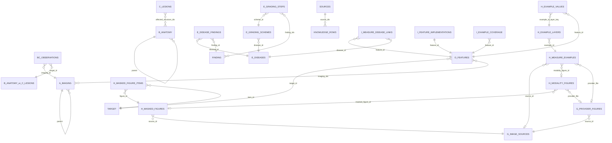

# 망막 영상 지도 데이터 스키마 v01

- 상태: CURRENT
- 작성일: 2026-11-23
- 소유: medical-image-atlas 망막 영역(`domains/retinal`, 웹 `retinal-atlas-web`)
- 표 위치: `docs/surveys/retinal_atlas_catalog/` (표 목록은 그 폴더의 [README](../surveys/retinal_atlas_catalog/README.md))
- 검사기: `code/check_retinal_atlas_registry.py` — 이 문서의 기본키·외래키·불변식은 검사기의 `SCHEMA`와 같다.
- 재구축 순서: [50_retinal_atlas_rebuild_runbook_v01_ko.md](50_retinal_atlas_rebuild_runbook_v01_ko.md)

## 1. 한눈에 보기

망막 영상 지도는 네 층의 데이터로 이뤄진다.

| 층 | 묻는 것 | 표 | 정본 여부 |
| --- | --- | --- | --- |
| 지식 A–F | 어떤 영상에서 무엇이 보이고, 무엇을 어떻게 재며, 어떤 질병의 근거인가 | `a_`·`b_`·`c_`·`bc_`·`d_`·`e_`·`f_`·`sources_` | 대부분 직접 작성 |
| 출처 G | 공개하는 영상이 어디서 왔고, 라이선스·체크섬은 무엇인가 | `g_image_sources`·`g_provider_figures` | 직접 작성(생성 코드가 읽음) |
| 산출물 H | 그 출처로 만든 그림·예시·층·값은 무엇인가 | `h_*` | 생성 |
| 파생 I | 구현 수준, 측정 → 질병 연결, 예시 범위 | `i_*` | 생성 |

여기서 `TARGET` = B 해부 ∪ C 병변 ∪ A 영상(영상 단위 특징), `FINDING` = B ∪ C ∪ D(질병 기준이 측정을 직접 부를 수 있다).

## 2. 공통 규약

- **파일 형식**: UTF-8 CSV, 첫 줄 헤더, 쉼표 구분, 필요하면 큰따옴표. 줄바꿈은 파일마다 기존 방식을 유지한다
  (`sources_v01.csv`만 CRLF, 나머지 LF).
- **판본**: 파일명 `_v01`은 표 구조 판본이다. 행을 더하거나 고칠 때는 같은 파일을 고친다. 열 구조를 바꿀 때만 `_v02`를 만든다.
- **여러 값**: 한 칸에 여러 ID를 넣으면 `;`로 구분한다(예: `img_cfp_45;img_fa`). 서술 칸 안에서는 쉼표 대신 `·`.
- **빈 값**: 선택 외래키는 비워 둘 수 있다. 기본키는 비우지 않는다(예외: 4.3의 대상 전체 지정 행).
- **한국어 열**: 이름이 `_ko`로 끝나는 열은 화면에 그대로 나가는 한국어 서술이다.
- **ID는 바꾸지 않는다**: 이름이 바뀌어도 ID는 유지한다. 지우는 대신 `status`로 표시한다.

### 2.1 ID 이름공간

| 접두사 | 뜻 | 정의 표 |
| --- | --- | --- |
| `img_` | 영상 종류·표현 | A `a_imaging_v01` |
| `ana_`·`ref_`·`zone_` | 해부 구조·위치 기준·구역 | B `b_anatomy_v01` |
| `les_` | 병변·소견 | C `c_lesions_v01` |
| `obs_` | 관측 | `bc_observations_v01` |
| `ft_` | 특징·측정 | D `d_features_v01` |
| `dis_` | 질병 | E `e_diseases_v01` |
| `rel_` | 질병–소견 관계 | `e_disease_findings_v01` |
| `gs_` / `st_` | 판정·등급 체계 / 그 단계 | `e_grading_schemes_v01` / `e_grading_steps_v01` |
| `src_` | 정의·분류·근거 문헌 | `sources_v01` |
| `r###`·`k###`·`e###`(+`a`·`b`) | 기존 측정 대응 규칙(출처별: 정량화 패키지·병변 계측·실험 등록부) | `f_mapping_rules_v01` |
| (접두사 없음, 소문자) | 영상 출처(데이터셋·논문), 예: `refined_idrid`·`guro2026` | G `g_image_sources_v01` |
| (공급자 파일명) | 논문 그림 파일 | G `g_provider_figures_v01` |
| `ex_` | 측정 표시 예시 | H `h_measure_examples_v01` |

`src_*`(지식 근거 문헌)와 G의 영상 출처는 **다른 이름공간**이다. 같은 논문이 두 곳에 나올 수 있으나 쓰임이 다르다
(정의의 근거 vs 화면에 나오는 영상의 출처).

### 2.2 검토 상태 어휘(`review_status`)

`draft` → `source_linked`(서지 연결) → `definition_checked_abstract`·`definition_checked` → `measurement_checked` →
`expert_reviewed`. 근거가 없는 질병 관계는 `needs_source`.

## 3. 지식 표 A–F

각 표의 기본키(PK)·외래키(FK)와 열 뜻. "→"는 참조 대상.

### 3.1 `a_imaging_v01.csv` — 영상 종류·표현 (23행)

PK `imaging_id`. FK `parent_id` → A, `source_ids` → `sources`(여러 값).

| 열 | 뜻 |
| --- | --- |
| `level` | `modality`(영상 종류) 또는 `representation`(같은 장비의 표현, 예: OCT B-scan·두께 지도) |
| `signal` · `dimensionality` | 신호의 물리적 성격 · `2D`·`3D`·`2D(시계열)` 등 |
| `shows` · `limits` | 이 영상이 직접 보여 주는 것 · 보여 주지 못하는 것 |
| `inclusion` | `detailed`(상세 조사) · `observability_only`(관측 가능성만) · `excluded` |

### 3.2 `b_anatomy_v01.csv` — 해부 구조·위치 기준·구역 (73행)

PK `entity_id`(`ana_`·`ref_`·`zone_`). FK `parent_id` → B, `best_imaging_ids` → A, `source_ids` → `sources`.

| 열 | 뜻 |
| --- | --- |
| `kind` | `region`·`structure`·`layer`·`band`·`vessel`·`boundary`·`reference`·`zone`·`measurement_region`·`common_target` |
| `obs_cfp` … `obs_icga` | 영상 종류별 신호 가용성 `direct`·`limited`·`none` |
| `definition_basis` | `standard_consensus`(합의 정의) · `service_draft`(서비스 초안) |
| `definition_check` | `needs_full_text`·`needs_expert_review`·`not_applicable` |
| `measure_class` | 공통 특징 집합을 고르는 측정 분류(`layer`·`structure`·`vessel`·`region`·`band`·`zone`) |
| `map_axis` · `map_order` · `map_subgroup` | 해부 지도 화면의 축(`depth`·`face`·`vessel`·`reference`·`hidden`)·순서·하위 묶음 |

### 3.3 `c_lesions_v01.csv` — 병변·소견 (117행)

PK `entity_id`(`les_`). FK `affected_structure_ids` → B(여러 값), `best_imaging_ids` → A, `source_ids` → `sources`.

| 열 | 뜻 |
| --- | --- |
| `lesion_group` | 화면 묶음(혈관성·출혈·신생혈관·삼출물·액체·유두·근시 등 20종) |
| `depth_ko` · `differentials_ko` | 깊이(층) 서술 · 감별할 소견 |
| `morphology_class` | 공통 특징 집합을 고르는 형태 분류(`focal`·`area`·`volumetric`·`deformation`·`diffuse`·`vascular_change`) |
| `definition_basis` | `standard_consensus`·`service_draft`·`research_definition` |

### 3.4 `bc_observations_v01.csv` — 관측 (131행)

PK `observation_id`. FK `target_id` → B ∪ C, `imaging_id` → A, `source_ids` → `sources`.
한 행 = "이 대상은 이 영상에서 이렇게 보인다(`observed_signal_ko`), 단 이렇게 해석한다(`interpretation_condition_ko`)".
신호(무엇이 보이는가)와 임상 해석을 분리하는 표다.

### 3.5 `d_features_v01.csv` — 특징·측정 (163행)

PK `feature_id`(`ft_`). FK `target_id` → TARGET, `imaging_ids` → A(여러 값), `definition_source_ids` → `sources`.

| 열 | 뜻 |
| --- | --- |
| `feature_role` | `measurement`(측정 목록 160개) · `classification`(판정 분류 3개, 측정 목록에 넣지 않음) |
| `feature_type` | `quantitative`(정량) · `qualitative`(정성) |
| `axis` | 측정 축(`area_volume`·`size_length`·`count`·`distance_angle`·`shape`·`presence_type` 등) |
| `output_type` | 출력 형태(`length`·`area`·`ratio`·`count`·`category`·`presence` 등) — F 대응의 호환 검사에 쓴다 |
| `region_spec` · `unit` · `requirements` | 측정 구역 · 단위 · 계산 조건(보정·정합 등, 없으면 `—`) |
| `imaging_ids` | 이 측정을 하는 영상 종류. **예시 범위(I `i_example_coverage`)의 기준이다** |
| `detail_stage` | 조사 단계(`1`·`2`) |

### 3.6 `d_common_feature_sets_v01.csv` · `d_applicability_overrides_v01.csv` · `d_feature_applicability_v01.csv`

- `d_common_feature_sets` (52행, PK `scope`+`class_id`+`feature_id`): 형태 분류(`scope=lesion`) 또는 측정 분류
  (`scope=anatomy`)마다 공통으로 적용하는 특징. FK `feature_id` → D.
- `d_applicability_overrides` (54행, PK `target_id`+`feature_id`): 대상별로 공통 적용을 바꾸는 지정
  (`applicability`: `direct`·`not_applicable`·`not_investigated`). FK `target_id` → TARGET, `feature_id` → D.
- `d_feature_applicability` (생성, 1,269행): 대상 × 특징 적용 결과. `basis`는 근거(`d_target`=D 표의 직접 대상,
  `class:<분류>`=공통 집합, `override`=지정).
- 위 두 표에서 **`feature_id`가 빈 행**은 "그 대상의 모든 특징"에 대한 지정이다(예: 위치 기준점은 자체 측정 없음).

### 3.7 `e_diseases_v01.csv` · `e_disease_findings_v01.csv` — 질병과 근거 관계

- `e_diseases` (65행, PK `disease_id`): FK `parent_id` → E(하위 질병), `classification_source_ids` → `sources`.
  `scope`는 `primary`(주요 39) · `secondary`(이차 26).
- `e_disease_findings` (300행, PK `relation_id`): 한 행 = 질병 하나와 소견·측정 하나의 관계.
  FK `disease_id` → E, `finding_id` → FINDING(B ∪ C ∪ D), `classification_source_id`·`evidence_source_ids` → `sources`.

| 열 | 뜻 |
| --- | --- |
| `relation_type` | `diagnostic_criterion`(진단 기준 소견) · `severity_classification`(단계 판정) · `activity_monitoring`(활동성·경과) · `prognostic`(예후) · `characteristic_nonspecific`(동반 소견, 비특이) |
| `classification_version` | 분류 판본(없으면 `—`) |
| `condition_ko` | 관계의 조건·문턱(화면에서는 질병 페이지에만 보이고 측정 목록에는 넣지 않는다) |
| `status` | 조사 단계(`stage1_drafted`·`stage2_expanded`·`stage2_secondary`) |

`finding_id`가 `ft_*`이면 **직접 관계**다(질병 기준이 그 측정을 부른다). `ana_*`·`les_*`이면 그 항목을 재는 측정이
**대상 항목을 거쳐** 질병과 이어진다. 두 경로를 합친 결과가 I `i_measure_disease_links`다.

### 3.8 `e_grading_schemes_v01.csv` · `e_grading_steps_v01.csv` — 판정·등급

- `e_grading_schemes` (62행, PK `scheme_id` `gs_*`): FK `disease_id` → E, `imaging_ids` → A, `source_ids` → `sources`.
  `kind`: `staging`·`diagnostic`·`typing`·`representative`. `read_rule_ko`는 판정 순서.
- `e_grading_steps` (148행, PK `step_id` `st_*`): FK `scheme_id` → 등급 체계, `finding_ids` → FINDING(여러 값).
  `step_order` 순으로 읽고 `logic`(`single`·`any`·`all`·`atleast2`·`atleast3`)으로 `finding_ids`를 결합한다.

### 3.9 `sources_v01.csv` — 지식 근거 문헌 (52행)

PK `source_id`(`src_*`). `source_type`(분류·임상 연구·진료지침·체계적 고찰 등), `verification`
(`pmid_checked`·`doi_checked`·`url_checked`·`pmid_candidate`·`citation_checked_pmid_pending`·`secondary_citation_only`·`internal`).
새 문헌은 PMID·DOI를 실제로 조회한 뒤 그 수준을 적는다.

### 3.10 `f_mapping_rules_v01.csv` · `f_existing_measurements_v01.csv` — 기존 측정 대응

- `f_mapping_rules` (108행, PK `rule_id`): 기존 측정 이름 패턴 → D 대상·특징·관계 유형. 위에서부터 첫 일치.
- `f_existing_measurements` (생성, 644행): 프로젝트 정량화 패키지·실험 등록부의 기존 측정 하나하나와 그 대응 후보.
  `relation_type`(`variant_specification`·`image_signal`·`derived`·`proxy`·`qc_validation`·`model_output`·`clinical_record`)
  은 I `i_feature_implementations`의 구현 수준을 정한다. 모두 `unreviewed_rule_candidate`(미검토).

## 4. 영상 출처 표 G (정본)

세 생성 코드(`build_atlas_masked_figures.py`·`build_atlas_modality_figures.py`·`build_measurement_examples.py`)는
`code/retinal_atlas_registry.py`를 거쳐 이 두 표만 읽는다. 출처·라이선스·체크섬을 코드에 다시 적지 않는다.

### 4.1 `g_image_sources_v01.csv` — 데이터셋·논문 (102행: 데이터셋 12, 논문 90)

PK `source_id`.

| 열 | 뜻 |
| --- | --- |
| `kind` | `dataset`(공개 데이터셋) · `article`(논문 그림) |
| `name` | 짧은 이름 |
| `credit` | 그림·예시 아래 출처 줄에 그대로 쓰는 표기(패널 포함, 예: `… Fig. 1`) |
| `citation` | 패널을 뺀 서지(영상 종류 그림은 패널을 따로 붙인다) |
| `title` · `doi` · `pmcid` · `url` | 논문 제목 · DOI · PMC ID(이번에 직접 받은 논문만) · 대표 링크 |
| `license` · `license_url` | `CC BY 4.0` 또는 `CC0 1.0`만 허용(검사기가 막는다) |
| `resource_path` | 데이터셋의 저장소 내 원본 위치(`resources/datasets/…`). 논문은 비움 |
| `note_ko` | 같은 논문의 다른 그림 키 등 주의점 |

같은 논문의 다른 그림을 다른 표기로 쓰면 키를 나눈다(`bai2026` Figure 4A · `bai2026_faf` Figures 3B·5B).

### 4.2 `g_provider_figures_v01.csv` — 논문 그림 파일 (95행)

PK `file`. FK `source_id` → G 영상 출처.

| 열 | 뜻 |
| --- | --- |
| `file` | `resources/datasets/retinal_atlas_modality_figures/provider_figures/` 안의 파일명 |
| `sha256` | 고정 체크섬. 생성 코드와 검사기가 파일이 바뀌면 멈춘다 |
| `provider_name` | 공급자 원본 파일명. 다른 파일과 겹쳐 학술지 접두어를 붙인 경우에만 `file`과 다르다 |
| `download_url` | 받은 주소(영상 종류 그림처럼 기록한 경우) |
| `used_by` | 쓰는 생성기 `masked_figures`·`modality_figures`·`measurement_examples`(여러 값) |

## 5. 산출물 표 H (생성)

`code/export_retinal_atlas_registry.py`가 웹 데이터 JSON과 G 표로 만든다.

| 표 | PK | FK | 뜻 |
| --- | --- | --- | --- |
| `h_masked_figures` (152) | `figure_id` | `source_id` → G | 항목 페이지 그림. 원 영상(`base_file`)·mask 겹침(`overlay_file`)과 체크섬, 원 파일(`source_file`), 변환(`transform`) |
| `h_masked_figure_items` (175) | `figure_id`+`item_id` | → H 마스킹 그림, `item_id` → TARGET | 그림 하나가 보여 주는 항목들 |
| `h_modality_figures` (14) | `figure_id` | `masked_figure_id` → H, `provider_file` → G 그림, `source_id` → G | 영상 종류 페이지 그림. `served=masked`는 마스킹 그림 재사용, `modality`는 논문 그림을 `crop_box`로 잘라냄 |
| `h_measure_examples` (89) | `example_id` | `source_id` → G 또는 `modality_figure_id` → H, `provider_file` → G 그림 | 측정 표시 예시 영상. `builder`는 그 예시를 만드는 `build_measurement_examples.py`의 함수 |
| `h_example_layers` (239) | `example_id`+`layer_key` | → H 예시 | 스위치 하나 = 층 하나. `kind=computed`면 `function`(retinal-measures 함수), `kind=reading`이면 계산 코드 없는 판독 항목 |
| `h_example_values` (331) | `example_id`+`layer_key`+`feature_id` | → H 층, `feature_id` → D | 층이 낸 측정값. `status`: `ok`·`not_observed`·`not_evaluable`·`reading` |

## 6. 파생 표 I (생성)

| 표 | PK | 뜻 |
| --- | --- | --- |
| `i_feature_implementations` (163) | `feature_id` | 구현 수준 `impl_level`(`auto`·`auto_seg`·`mask`·`model`·`package`·`proxy`·`record`·`none`), retinal-measures 함수·입력, F 기존 측정 수 |
| `i_measure_disease_links` (315) | `feature_id`+`disease_id` | 측정 → 질병. `link_kind=direct`(질병 관계·등급 단계가 측정을 직접 부름) 또는 `via_item`(`via_item_id` 항목의 질병 관계). 질병 하나당 한 행, 직접이 우선 |
| `i_example_coverage` (326) | `feature_id`+`example_modality` | D `imaging_ids`가 가리키는 영상 종류마다 예시가 있는지(`yes`·`no`), 해당 종류가 아닌데 예시가 있으면 `extra` |

`example_modality`는 예시 카드의 영상 종류 8가지(`cfp`·`uwf`·`fa`·`faf`·`nir`·`icga`·`oct`·`octa`)이고, `img_*` 접두사로
정한다(`img_octa*`→octa, `img_oct*`→oct, `img_cfp*`→cfp, `img_uwf`→uwf, `img_faf`→faf, `img_nir`→nir, `img_fa`→fa, `img_icga`→icga).

## 7. 웹 서비스가 읽는 파일과의 관계

| 웹 데이터 파일(`packages/retinal-atlas-web/src/retinal_atlas_web/data/`) | 만드는 코드 | 표로 펼친 곳 |
| --- | --- | --- |
| `atlas.json` | `build_retinal_atlas_catalog.py` (A–F) | A–F 자체, I |
| `masked_figures.json` | `build_atlas_masked_figures.py` (+G) | `h_masked_figures`·`h_masked_figure_items` |
| `modality_figures.json` | `build_atlas_modality_figures.py` (+G) | `h_modality_figures` |
| `measurement_examples.json` | `build_measurement_examples.py` (+G) | `h_measure_examples`·`h_example_layers`·`h_example_values` |
| `catalog.json`·`image_links.json`·`item_schematics.json`·`oct_layer_colors.json` | 각 생성 코드(지도 화면 보조) | 이 판본에서는 표로 펼치지 않음 |

측정 → 질병 연결은 웹 서비스와 내보내기가 같은 함수(`retinal_atlas_web/disease_links.py`)를 쓴다.

## 8. 불변식(검사기가 확인)

1. 모든 표가 `SCHEMA`에 있고, 각 표의 기본키가 비지 않고 겹치지 않는다(3.6의 대상 전체 행 예외).
2. 모든 외래키 값이 참조 표에 있다(여러 값 칸은 값마다).
3. G 영상 출처의 라이선스는 `CC BY 4.0`·`CC0 1.0`뿐이고, `credit`·`url`이 있다.
4. G 논문 그림 파일이 `provider_figures/`에 있고 SHA-256이 일치한다.
5. H의 원 영상·겹침·층 그림 파일이 해당 `resources/datasets/retinal_atlas_*` 폴더에 있다.
6. 예시마다 출처(`source_id` 또는 `modality_figure_id`)가 있고, 판독 층만 계산 함수가 비어 있다.
7. 측정값 상태는 네 가지 중 하나다.
8. H·I 생성 표가 현재 JSON·지도 데이터와 같다(아니면 내보내기를 다시 돌리라고 알린다).
9. 경고(실패 아님): 데이터셋 원본이 로컬에 없음, 해당 영상 종류에 예시가 없는 측정.
